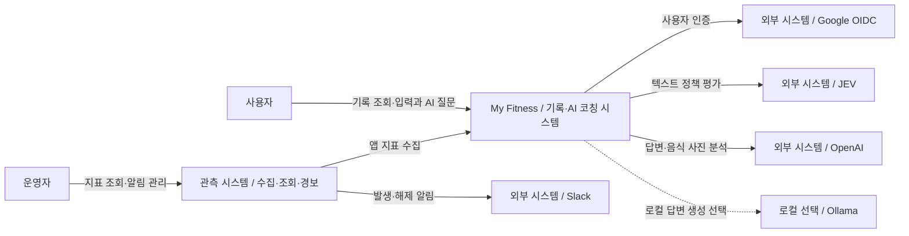
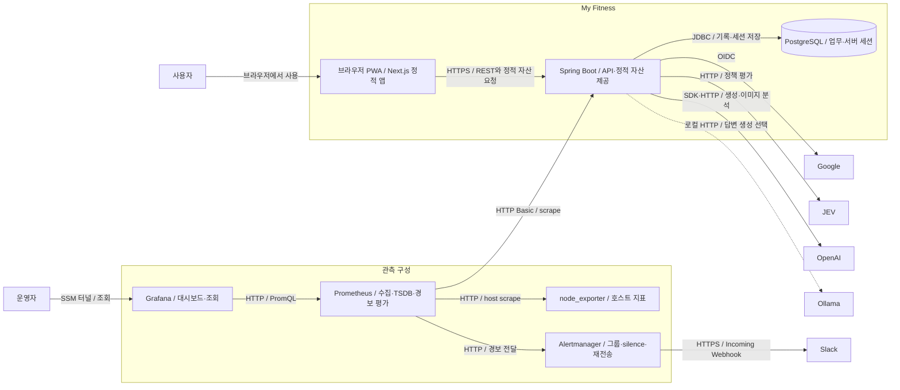

# 소프트웨어 구조와 경계

단일 Spring Boot 배포 단위의 Modular Monolith다. Next.js의 정적 PWA를 JAR에 포함하고
브라우저는 REST API를 호출한다. 모듈·계층 경계는 Spring Modulith·ArchUnit·Checkstyle로 검증한다.
사용자 기능은 [Product](product.md), AI 처리 계약은 [AI](ai.md), AWS 구성은 [Infrastructure](../infra/README.md)에 둔다.

## C1 Context

사용자와 외부 시스템의 관계다. 업무 앱과 관측 시스템의 역할을 구분한다.



## C2 Container

C4의 Container는 실행 애플리케이션·데이터 저장소를 뜻하며 Docker 컨테이너 수와 같지 않다.
아래는 논리적 실행 구성이다. 서버별 실제 배치·포트·네트워크는 [운영 Deployment](../infra/README.md#운영-deployment)를 따른다.



Next.js를 별도 Node 서버로 운영하지 않는다. `frontend/out`은 BootJar의
`BOOT-INF/classes/static`에 포함한다. Google은 외부 인증을, Spring Session JDBC는 서버 세션을 담당한다.
PWA와 Backend는 실행 책임이 다르지만 정적 자산과 서버는 하나의 JAR/image로 배포한다.
실행·빌드는 [Backend](backend/README.md)와 [Frontend](../frontend/README.md), 수집 절차는 [Monitoring](../monitoring/README.md)에 둔다.

## 상세 구조와 결정

C1·C2와 Deployment를 현재 기준으로 유지한다. C3는 변경 시 이해가 필요한 모듈·처리 흐름에만 작성한다.
Backend 모듈 관계는 아래 공개 계약과 `modulithDocs` 생성물을 활용한다. 모든 클래스의 C4 Code 그림을 수동 관리하지 않는다.
[C4 공식 정의](https://c4model.com/diagrams), 선택 근거는 [ADR 목록](../README.md#아키텍처-결정)을 참조한다.

## 모듈과 공개 계약

| 모듈 | 책임 |
| --- | --- |
| user | Google OIDC 사용자 식별·인증 컨텍스트 |
| exercise | 기본 운동·사용자 운동·공통 운동 참조 |
| workout | 운동·종목 snapshot·세트·완료 상태 |
| routine | 운동 템플릿과 루틴 기반 운동 시작 |
| body | 측정 시각에 따른 신체 기록 |
| nutrition | 직접 식단 입력·영양 목표·집계 |
| dashboard | 운동·신체 공개 데이터를 조합한 통계 |
| ai | 기록 Context 기반 대화와 사진 분석 |
| common | 공통 기술 설정·HTTP 오류 변환 |

| Consumer → Provider | 허용 Named Interface |
| --- | --- |
| workout → exercise | catalog |
| routine → exercise | catalog |
| routine → workout | routine-api |
| dashboard → workout / body | insight |
| ai → workout / body / nutrition | insight |

`package-info.java`의 `allowedDependencies`와 `@NamedInterface`가 공개 범위를 정의한다.
다른 업무 모듈은 호출 모듈의 Output Port와 Module Adapter를 거쳐 상대 Input Port를 동기 호출한다.
Adapter가 상대 값을 호출 모듈의 타입으로 변환한다. `workout`과 `routine`은 운동 종류·카테고리를 자신의
모델에 저장하고, 루틴에서 운동을 시작할 때 저장한 이름·카테고리를 값으로 전달한다.
후속 작업의 비동기 event·재시도·중복 처리 프레임워크는 현재 도입하지 않았다.

## 모듈 내부 패키지

```text
<module>/
├── presentation/
│   ├── controller/
│   └── dto/request/, dto/response/
├── application/
│   ├── port/in/, port/out/
│   ├── usecase/ (내부 계약, request/, response/)
│   ├── service/
│   └── support/
├── domain/model/, domain/exception/, domain/repository/
└── infrastructure/
    ├── persistence/
    ├── module/
    └── client/
```

실제로 필요한 패키지만 만든다. Application의 설정·예외는 별도 역할 패키지를 사용할 수 있다.

| 위치 | 책임·허용 경계 |
| --- | --- |
| Presentation | HTTP 입력 검증과 응답 변환, 자기 모듈의 Input Port 호출 |
| Input Port | 공개 입력·결과와 값 DTO |
| PortService | 공개·내부 값 변환과 내부 UseCase 위임 |
| 내부 UseCase와 업무 Service | 내부 업무 계약과 실행 순서, 트랜잭션 |
| Application Support | Context·prompt·policy·history 등 내부 협력 기능 |
| Domain | 업무 규칙과 모델, Aggregate 영속 계약을 정의하는 Domain Repository |
| Output Port | 검색·집계 projection, 타 모듈 조회와 외부 연동 계약 |
| Infrastructure persistence | 자기 모듈의 Domain Repository와 조회 Output Port 구현 |
| Infrastructure module | 다른 모듈의 공개 Input Port 호출과 값 변환 |
| Infrastructure client | 외부 HTTP·SDK·파일 처리·wire 검증 |

`insight`는 모듈 간 읽기에 사용하는 공개 Input Port다.
JEV 정책 client와 Spring AI 답변 client는 역할이 다르지만 동일한 client 분류 안에 둔다.
인증·설정·초기 데이터의 security/config/bootstrap은 별도 책임 패키지로 유지한다.
Spring Data Repository와 Adapter는 같은 persistence에 두고 Repository의 package-private 접근을 유지한다.
패키지를 분리하려고 기술 interface를 public으로 노출하지 않는다.

## DTO와 책임 분리

HTTP DTO는 Presentation에 둔다. Input Port는 `application/port/in`의 값이나 표준 Java 타입으로
계약을 표현한다. PortService가 내부 UseCase와 공개 계약 사이를 변환한다. 내부 입력과 결과는
`application/usecase` 아래에서 소유한다. Output Port 전용 값은 해당 Port의 계약에 둔다.

Entity에서 값을 만드는 변환은 내부 업무 Service나 Persistence Adapter가 담당한다.
JSON 해석처럼 별도 협력이 필요한 변환은 구체 Support mapper가 맡는다.
통계·목표 차감·빈도 집계 같은 계산 책임은 Builder·Assembler·Service에 유지한다.
보조 기능은 의미 있는 메서드나 응집된 구체 클래스로 분리하고 한 줄에 선언·대입을 압축하지 않는다.
Java `var` 선언은 가독성 컨벤션으로 금지하며 이름·주석·문자열의 var까지 금지하지 않는다.

현재 규모에서는 Domain Entity에 JPA mapping annotation을 허용한다.
동일한 Domain/Persistence Entity를 별도로 복제하지 않는다.

## 트랜잭션과 데이터 경계

공개 업무의 진입을 처리하는 Service와 기존 AI 저장 트랜잭션 Service가 기본 read-only 경계와 쓰기 메서드의
트랜잭션을 선언한다. 업무 간 호출은 모듈 내부 UseCase를 사용한다. 진입 트랜잭션 안에서 실행하는
운동·루틴·식단의 협력 UseCase는 호출자의 트랜잭션에 참여한다.
Repository의 암묵적 transaction만으로 유스케이스 경계를 대신하지 않는다.
외부 AI 호출은 NOT_SUPPORTED 경계에서 실행하고 앞뒤 저장을 별도 짧은 transaction으로 나눈다.
텍스트 조율은 `AiChatMessageService`, 사진 조율은 `FoodPhotoService`, 저장은 각각의 transaction Service가 맡는다.
Support가 저장 Service를 역참조하지 않는다.

JPA Entity는 트랜잭션 안에서 필요한 값으로 변환한다.
`open-in-view=false`, `hibernate.ddl-auto=none`을 유지하고 schema·세션 테이블 변경은 Flyway로 관리한다.
과거 migration을 덮어쓰지 않는다. schema 복구는 [배포 가이드](../infra/README.md#v11-schema와-복구)를 따른다.

운동·루틴은 카탈로그 이름·카테고리 snapshot으로 과거 기록을 보존한다.
식단은 직접 입력값을 저장하며 일괄 등록 전체를 하나의 쓰기 transaction으로 처리한다.
영양소의 null은 미입력, 0은 알려진 값으로 구분한다. 화면 동작은 Product를 따른다.

## 검사의 책임

| 검사 | 강제하는 것 |
| --- | --- |
| ModulithArchitectureTest | 모듈 의존·순환·공개 API·허용 목록 |
| LayerArchitectureTest | 내부 의존 방향·Port 계약·Support 역참조·Presentation 구현 참조 금지 |
| PortBoundaryArchitectureTest | Input Adapter의 내부 호출 우회, 공개 Port와 PortService의 내부 의존, 구체 Service와 타 모듈 직접 의존, Domain Repository 기술 의존, 이전 DTO 패키지 사용 금지 |
| PersistenceBoundaryArchitectureTest | Entity 비노출·JPA 배치·업무 Service 기본 트랜잭션 선언 |
| ComponentConventionTest | Spring 컴포넌트·역할 패키지·Command/Result 위치 |
| Checkstyle Main/Test | Java AST의 var 타입 선언 금지 |
| JavaConventionTest / ArchitectureRuleDetectionTest | 정상·금지 fixture와 규칙 자체의 탐지 능력 |
| EntityBoundaryApiIntegrationTest | 테스트 transaction 없이 실제 요청 종료 후 projection 조회 |

실행 명령과 동작 테스트 기준은 [Testing](testing.md)에 둔다.
규칙을 통과하려고 허용 의존성·예외·기준선을 임의로 완화하지 않는다.

`modulithDocs`는 `build/spring-modulith-docs`에 Backend 모듈 관계와 canvas를 생성한다.
생성물을 일반 테스트에 섞거나 이 문서의 외부 시스템 설명을 대체하지 않는다.
